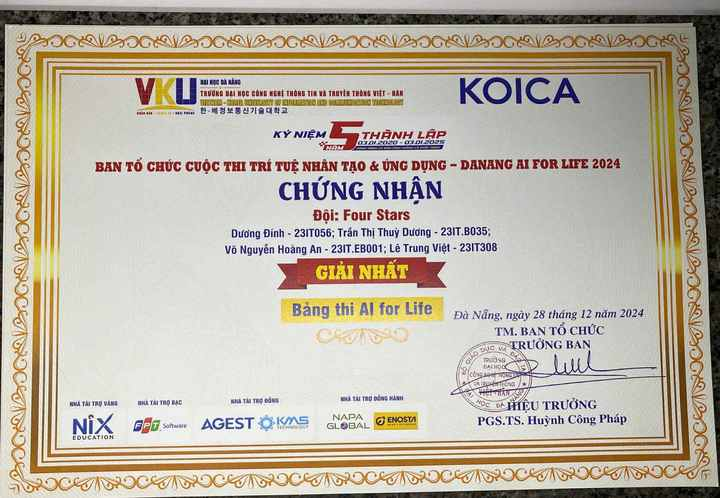
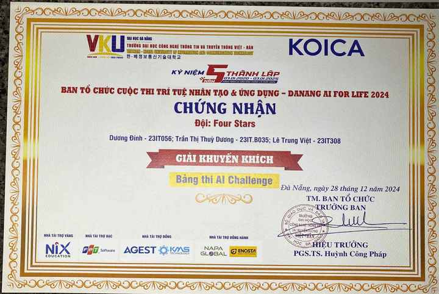
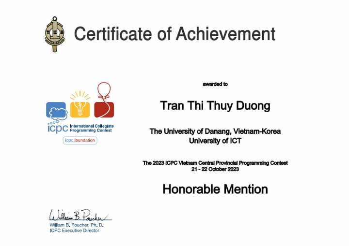
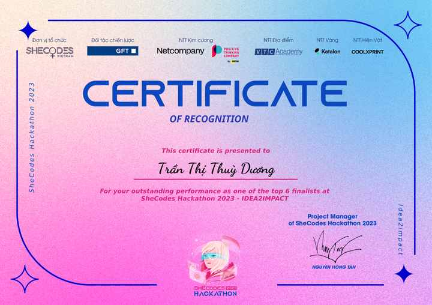

# Hi, I'm Thùy Dương 👋

**Full-stack developer (AI-integrated) · Business Analyst** · Software Engineering @ VKU, Da Nang

I take products from the first requirement to a running system: React / Node.js / FastAPI web apps with AI built in (computer vision, NLP, RAG), and once, a blockchain layer. I've led small teams through scoping, backlog and delivery, and worked with partners in Korea and Thailand.

- 🏆 First Prize, Danang AI for Life 2024 · ICPC Vietnam Central Honorable Mention 2023
- 🔭 Now building **UniAI Assistant**, grounded Q&A over university regulations (AI Living Lab 2026)
- 🌏 Vietnamese · English (TOEIC 735) · Chinese (HSK4) · learning Korean and Thai
- 📫 [duongttt.id.vn](https://duongttt.id.vn) · duongttt.dev@gmail.com

## 🔧 Tech Stack

**Frontend**

  

**Backend & Data**

  

**AI / ML · Blockchain · DevOps**

  

**Business analysis:** requirements & user stories · process modelling · traceability · backlog & release planning · UI/UX prototyping

---

## 🚀 Featured Projects

| Project | What it is | Stack |
|---|---|---|
| 🌱 **GreenChain** | Farm-to-shelf traceability: every supply-chain step signed on-chain, YOLOv8 spoilage check and XGBoost quality score with SHAP. I led the project and built the full stack. | Solidity · Node.js · React · FastAPI · PostgreSQL |
| 🎓 **UniAI Assistant** | RAG over university regulations: cites down to the clause and refuses without evidence. VI / EN / KO. | FastAPI · Qdrant · Redis · React |
| 📊 **VKU TeachingQC** | Sentiment analytics of 120k+ student comments with PhoBERT and an ontology / knowledge graph. | PhoBERT · RDF/SPARQL · FastAPI · React |
| 🧾 **ExScan** | Transcript scanning with YOLOv8 + Transformer OCR. First Prize, AI for Life 2024. PM & BA. | Python · React |
| 🕸️ [**PropaGraph**](https://github.com/thuyduong115/PropaGraph-Fake-news-detection) | Fake-news detection from propagation graphs (GCN, GAT, GraphSAGE, GIN) with an early-detection demo. | PyG · FastAPI · React |
| 🗓️ [**My Work Assistant**](https://github.com/thuyduong115/my-work-assistant) | Offline-first PWA: an LLM turns free-text plans into scheduled tasks. [Live demo](https://thuyduong115.github.io/my-work-assistant/) | React 19 · TypeScript · Supabase |
| 🛡️ [**QueryShield Lab**](https://github.com/thuyduong115/queryshield-lab-SQLi) | SQL injection lab: the same queries with string concatenation vs. bound parameters, side by side. | Python · PostgreSQL |

---

## 📊 GitHub Stats

<table>
  <tr>
    <td width="60%"></td>
    <td width="40%"></td>
  </tr>
  <tr>
    <td width="60%"></td>
    <td width="40%"></td>
  </tr>
</table>

---

## 🏆 Certificates

<table>
  <tr>
    <td width="50%"></td>
    <td width="50%"></td>
  </tr>
  <tr>
    <td width="50%"></td>
    <td width="50%"></td>
  </tr>
</table>

Also: 🥉 Third Prize – Danang AI4Life 2025 (AI Challenge) · ⭐ Top 100 – AI Thực Chiến 2025 · 🇰🇷 Hanwha Life Future Plus Fintech Student Excellence Program 2025
